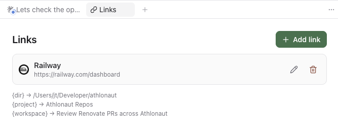

# paseo-workspace-links

A [Paseo](https://paseo.sh) plugin that adds a **Links** panel to every workspace: a per-project list of quick links that open in your browser, with template variables resolved live from the workspace's git state.

Add a link like `https://railway.app/project/xyz/settings?branch={branch}` once, and every workspace (including worktrees) of that project gets a button that opens the right page for *its* branch.



## Features

- **Links workspace panel** — lives beside agents, terminals, files, and diffs. Also reachable via ⌘K → "Open workspace links".
- **Template variables** — resolved per workspace via a daemon-side git RPC (refreshed every 30s):

  | Variable | Resolves to |
  | --- | --- |
  | `{branch}` | current git branch |
  | `{repo}` | repo slug from `origin`, e.g. `owner/name` |
  | `{repoUrl}` | web URL derived from `origin` |
  | `{remote}` | raw `origin` remote URL |
  | `{dir}` | workspace directory |
  | `{project}` | Paseo project display name |
  | `{workspace}` | Paseo workspace name |

  The panel shows the live value of each variable for the current workspace.

- **Auto title + favicon** — paste a URL and the plugin fetches the page `<title>` and favicon from the daemon; both stay editable, and the favicon shows in each link row.
- **Per-project persistence** — links are shared across all workspaces/worktrees of a project, stored in `<PASEO_HOME>/plugin-data/workspace-links.json` on the daemon machine.

## Install

Plugins must be enabled on your daemon (**Settings → Plugins → Enable plugins**). Then:

```bash
paseo plugin add GreenJimmy/paseo-workspace-links
```

Or from a local clone:

```bash
git clone https://github.com/GreenJimmy/paseo-workspace-links
paseo plugin add /absolute/path/to/paseo-workspace-links
```

> Paseo plugins are trusted, unsandboxed code. Read the source before installing — it's short. The daemon side of this plugin runs `git` in workspace directories, fetches URLs you add to resolve their title/favicon, and reads/writes its own JSON file under `PASEO_HOME`.

## Develop

```bash
npm install
npm run typecheck
paseo plugin reload workspace-links
paseo plugin logs workspace-links
```

- `index.ts` — contributions + daemon-side RPC handlers (git info, URL metadata, link storage)
- `links.client.tsx` — the panel UI (React Native, theme-aware, works on desktop and mobile)
- `shared.ts` — Zod RPC contracts shared by both sides

## Known limitations

- Links open in your system browser. Paseo's plugin API doesn't (yet) expose the embedded workspace browser or the workspace header row, so this can't be a header button next to VS Code/Finder.
- Sites that block anonymous requests won't yield a title/favicon; type your own title and paste any image URL as the favicon.

## License

MIT
